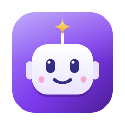
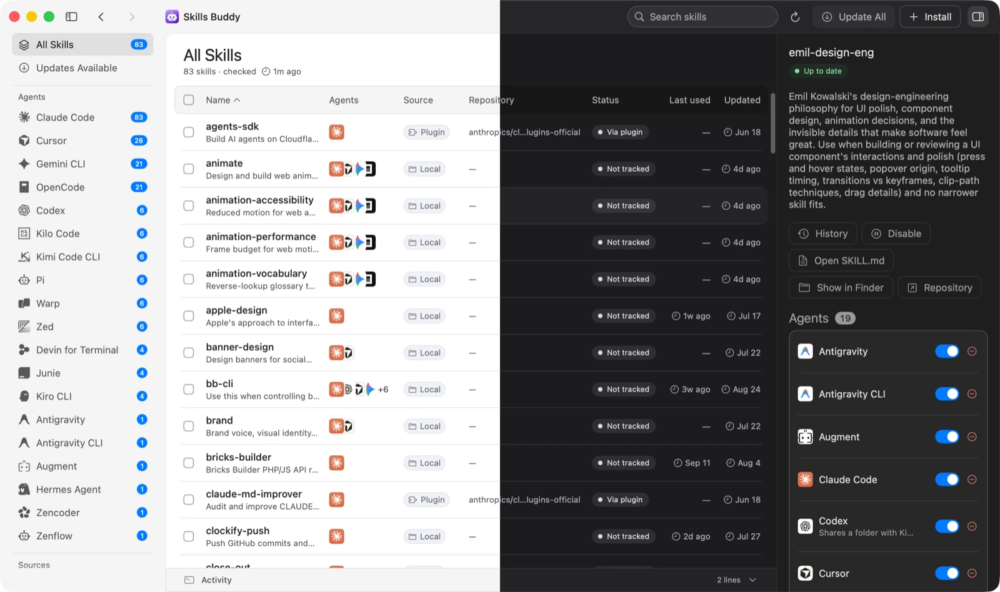

<p align="center">
  
</p>

<h1 align="center">Skills Buddy</h1>

<p align="center"><strong>Every agent skill you have, kept up to date.</strong></p>

<p align="center">
  
</p>

A native macOS app for the skills your coding agents load. It finds every installed skill — for Claude Code, Codex, Cursor, Gemini CLI and the rest — shows where each one came from, and updates it from there. Built with SwiftUI on [BlissUI](https://github.com/portseif/bliss-ui).

- **Every agent** — reads the skills of all 79 agents the [`skills` CLI](https://github.com/vercel-labs/skills) knows, plus the skills inside Claude Code plugins. A skill several agents share shows up once, with each agent that loads it.
- **Where it came from** — each skill is tagged by source: the Skills CLI, a git clone, a plugin, or a local folder with no source at all.
- **Updates** — check everything at once, then update one skill or all of them. CLI skills update in a single `skills` run, git skills with one pull per clone.
- **Install** — paste `owner/repo`, a git URL or a GitHub link to a folder, pick the skills you want, and choose which agents get them. Other agents are left alone.
- **History** — the commits that changed a skill's folder as a graph, with the one you have installed marked and Restore on each version.
- **Disable** — no agent has a "disabled" setting, so Skills Buddy moves the skill out of the agent's folder and back again later: same files, same version, no network.
- **Last used** — when each skill last ran, read from Claude Code's session transcripts.
- **Find repositories** — local skills with no source get matched to their GitHub repo: an identical SKILL.md is found by its git hash, and Apple Intelligence judges the near matches on-device. Attach the repo and the skill updates from there.
- **Themes** — its own violet theme plus BlissUI's, in Light, Dark or System, with a Violet or Midnight Dock icon.

## Requirements

- macOS 15 or later (Find Repositories uses Apple Intelligence on macOS 26 when it's turned on, and falls back to exact and close-text matches without it)
- Xcode 27 or later to build
- Node.js with `npx`, for the `skills` CLI — without it, Skills Buddy falls back to Claude Code's `~/.claude/skills` and plugins
- `git`, for git skills and history
- The [GitHub CLI](https://cli.github.com) (`gh`), signed in — only for Find Repositories

## Building

Skills Buddy builds against a BlissUI checkout next to it (`../bliss-ui`), since it uses components that aren't in a BlissUI release yet. Clone both into the same folder:

```bash
git clone https://github.com/portseif/bliss-ui.git
git clone https://github.com/portseif/skills-buddy.git
open skills-buddy/SkillsBuddy.xcodeproj
```

Then run the **SkillsBuddy** scheme. From the command line, inside `skills-buddy`:

```bash
xcodebuild -project SkillsBuddy.xcodeproj -scheme SkillsBuddy -configuration Debug -derivedDataPath .build/DerivedData build
xcodebuild -project SkillsBuddy.xcodeproj -scheme SkillsBuddy -configuration Debug -derivedDataPath .build/DerivedData test
```

The Xcode project is generated from `project.yml` with [XcodeGen](https://github.com/yonaskolb/XcodeGen) — run `xcodegen generate` after adding or removing files.

The app isn't sandboxed: it reads `~/.claude` and `~/.agents`, moves skill folders, and runs `git`, `npx` and `gh`.

## Keyboard shortcuts

| Shortcut | Action |
| --- | --- |
| ⌘R | Rescan and check for updates |
| ⇧⌘U | Update every skill with an update |
| ⌘N | Install a skill |
| ⌘F | Search skills |
| ⌘[ / ⌘] | Back / forward through the sidebar filters |
| ⌥⌘I | Show or hide the inspector |
| ⌃⌘S | Show or hide the sidebar |
| ⌘, | Settings |

## What leaves your Mac

- **Find Repositories** sends skill names, and the search phrases Apple Intelligence suggests, to GitHub's code search through `gh`. Descriptions are compared on this Mac.
- **Agent logos** come from Google's favicon service. Only the agent's domain is sent, and each logo is cached after the first fetch.
- **Installs, updates and history** talk to the skill's own git remote, the same as running `git` or `npx skills` yourself.

Usage, history and everything else are read from your own files.

## Project layout

- `SkillsBuddy/Services` — the scanner, the `skills` CLI and git drivers, the transcript reader, and the repo finder's GitHub search and matching
- `SkillsBuddy/Stores` — `SkillLibrary`, the app's state and actions, plus the repo finder and agent logos
- `SkillsBuddy/Views` — the window, sidebar, skill table, inspector, sheets and settings
- `SkillsBuddy/Resources/Agents.json` — the agent registry, generated from the `skills` CLI's agent list by `scripts/generate-agent-registry.py`
- `design/` — the app icon sources, rendered into the asset catalog by `scripts/render-app-icon.sh`

## License

MIT — see [LICENSE](LICENSE).
